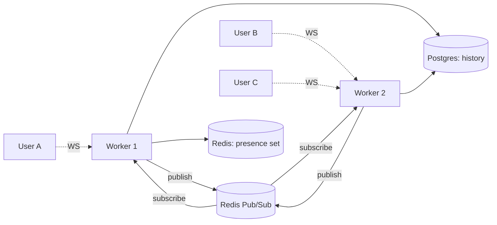

# Realtime Chat — FastAPI + WebSockets + Redis Pub/Sub

[CI results](https://github.com/umairjutt/realtime-chat-fastapi/actions) · [Engineering guide](PORTFOLIO.md)

> **Status:** Realtime architecture demo. CI builds the images; token compatibility, presence and slow-client behavior require runtime verification.

A WebSocket chat demo using Redis pub/sub across FastAPI worker processes, with PostgreSQL for message history.

## What this demonstrates

- **FastAPI WebSocket** endpoints with async handlers
- **Redis Pub/Sub** for cross-worker message fan-out
- **Room-based** chat (multi-user channels)
- **Presence tracking** (who's online) backed by Redis sets with TTL
- **Persistent history** in Postgres (last 50 messages on join)
- **JWT auth** at the WebSocket handshake using a query token in this demo
- **Bounded broadcast queues** — per-connection `asyncio.Queue`; overflow currently drops messages
- **Minimal React frontend** to interact with it

## Architecture



The key trick: every worker subscribes to `room:{id}` channels on Redis. When User A sends a message, Worker 1 publishes to Redis; Worker 2 receives it and forwards to Users B + C over their sockets. This illustrates the intended message path; production delivery and recovery guarantees have not been established.

## Tech stack

- Python 3.11, FastAPI, uvicorn (4 workers)
- redis-py (async client)
- asyncpg + SQLAlchemy 2.0 async
- PostgreSQL 16
- React + Vite + TypeScript (minimal client)

## Quick start

```bash
docker compose up --build
# Backend:  http://localhost:8000
# Frontend: http://localhost:5173
# Open the frontend in 2 browser tabs to chat with yourself
```

Default users (seeded): `alice/password`, `bob/password`, `charlie/password`.

## API surface

| Type | Path                          | Description                       |
|------|-------------------------------|-----------------------------------|
| POST | `/auth/login`                 | Returns JWT                       |
| GET  | `/rooms`                      | List rooms                        |
| POST | `/rooms`                      | Create room                       |
| GET  | `/rooms/{id}/messages`        | Last 50 messages                  |
| WS   | `/ws/{room_id}?token=...`     | Open WebSocket connection         |

## WebSocket protocol

Client -> server messages (JSON):
```json
{ "type": "message", "text": "hello" }
{ "type": "typing", "value": true }
```

Server -> client messages:
```json
{ "type": "message", "user": "alice", "text": "hi", "ts": "2026-01-01T00:00:00Z" }
{ "type": "presence", "online": ["alice", "bob"] }
{ "type": "typing", "user": "alice", "value": true }
```

## Roadmap

- File attachments via presigned S3 URLs
- E2E encryption (libsignal)
- Replace single Postgres history with append-only Kafka topic for true scalability

<!-- ownership:author -->
---

## Author

**Umair** &mdash; [@umairjutt](https://github.com/umairjutt)

Maintained by [Umair Jutt](https://github.com/umairjutt). See [LICENSE](LICENSE) for repository licensing.
